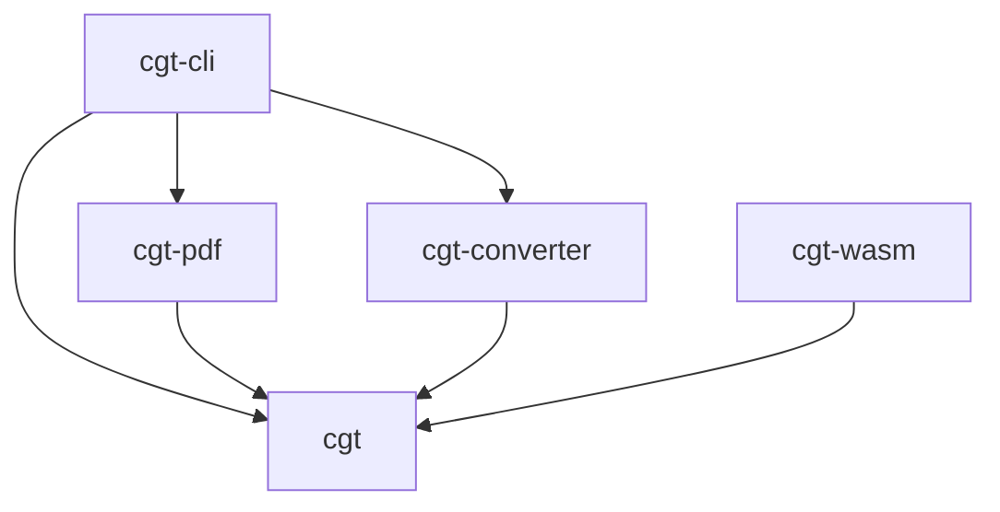

# Architecture

This document explains the module boundaries and calculation pipeline for contributors.
The core library performs no file or network IO, so the CLI and WebAssembly bindings use the same engine.
The engine plans share matches before it calculates their costs.

Related documents: [behavioral specification](spec.md) and [tax rules](tax-rules.md).

## Crate boundaries

| Crate                                                 | Responsibility                                                                                                                |
| ----------------------------------------------------- | ----------------------------------------------------------------------------------------------------------------------------- |
| [`cgt`](../crates/cgt/src/lib.rs)                     | Money, foreign exchange, transaction parsing and serialization, validation, matching, the report model, and plain-text output |
| [`cgt-cli`](../crates/cgt-cli/src/main.rs)            | File IO, configuration discovery, command handling, and output selection for `cgt-tool`                                       |
| [`cgt-converter`](../crates/cgt-converter/src/lib.rs) | Schwab exports to transaction text, with strings as input and output                                                          |
| [`cgt-pdf`](../crates/cgt-pdf/src/lib.rs)             | PDF output through embedded Typst and bundled fonts                                                                           |
| [`cgt-wasm`](../crates/cgt-wasm/src/lib.rs)           | Browser and Node.js bindings for the engine                                                                                   |

Foreign exchange rates come from `hmrc-rates` at build time.
Library callers supply transaction data and configuration directly.
Keeping Typst in `cgt-pdf` excludes its engine and fonts from WebAssembly builds.

## Calculation pipeline

A match leg is a portion of a disposal assigned to one matching rule.
The pipeline separates share quantities from monetary values.
Each stage completes before the next stage starts:

1. The [parser](../crates/cgt/src/dsl/parse.rs) turns transaction text into typed records with source locations.
2. The [validator](../crates/cgt/src/validate.rs) rejects invalid fields and conflicts between records.
3. [Normalization](../crates/cgt/src/engine/normalize.rs) converts money to GBP and groups trades by date, ticker, and action.
4. The [planner](../crates/cgt/src/engine/plan.rs) assigns quantities to Same Day, Bed & Breakfast, and Section 104 matches.
5. [Valuation](../crates/cgt/src/engine/value.rs) assigns acquisition costs and the Section 104 cost at each disposal date.
6. [Report assembly](../crates/cgt/src/engine/report.rs) groups disposals and income by tax year and applies exemptions.

The planner scans events chronologically and looks ahead for acquisitions within 30 days.
It reserves quantities for Same Day matches before allocating shares to earlier disposals.
Indexes by ticker and by sale date support these lookups, with storage proportional to the event count.

The planner uses exact fractions for quantities and split ratios.
It tracks actual shares separately from the Section 104 tax pool.
Every sale reduces actual shares, including a sale whose tax cost comes from a later acquisition.
Conversion to public decimal values returns an error for unsupported magnitudes or share precision.

Valuation replays events chronologically.
Same Day and Bed & Breakfast legs use their matched acquisition costs.
Section 104 legs use the pool cost at the disposal date.
Later capital returns and accumulation dividends adjust the carried-forward pool without changing earlier disposal costs.

Each acquisition and pool retains its unallocated quantity and cost.
Partial allocations receive a proportional amount, and the final allocation receives the complete remainder.
The same method allocates disposal proceeds and fees without losing residual amounts through rounded unit prices.

## Shared input and output models

One validator serves transaction construction, JSON deserialization, explicit validation, and calculation.
Rules for one record remain separate from conflicts between records.
The [grammar](../crates/cgt/src/dsl/grammar.pest) and [serializer](../crates/cgt/src/dsl/serialize.rs) define the transaction text format.

The converter retains signed amounts and source records until it reconciles corrections, cancellations, and withholding.
Award lookup retains all candidates and rejects ambiguous matches.
Resolved records use core transaction types and the core serializer.
Conversion does not read the clock, so identical inputs produce identical output.

Calculation JSON serializes [`TaxReport`](../crates/cgt/src/report.rs).
The model retains precise match values, and each disposal rounds its complete cost and gain once.
Serializers distinguish monetary totals from exact quantities and holding costs.

All outputs use the calculation report and its shared rounding rules.
The specification defines the [public fields and rounding rules](spec.md#reports).

## Testing and cross-validation

Golden files store expected output for fixed transaction inputs.
Tests compare parsed JSON values with [`tests/json/`](../tests/json/) and compare plain text byte-for-byte with [`tests/plain/`](../tests/plain/).
Additional tests cover input validation, exact arithmetic, PDF text, browser formatting, and WebAssembly behavior.
The specification links [representative inputs and focused tests](spec.md#test-references).

Never remove or modify tests without proving that their expectations are incorrect.
Derive each changed numerical expectation independently from its source transactions and the applicable tax rules.
A passing suite proves agreement with its expectations, not their independent correctness.

[`scripts/cross-validate.py`](../scripts/cross-validate.py) compares annual gains and losses with `cgtcalc` and `cgt-calc`.
Unexpected execution errors or incomplete summaries fail the run.
Unsupported inputs appear as explicit skips, and two documented corporate-action differences appear as known results.
By default, at least one `cgtcalc` comparison must complete.
`CGT_REQUIRE_CGTCALC=0` permits `cgt-calc` alone, but still requires a completed comparison.

The tolerance is £1 per tax year.
For `cgtcalc` whole-pound output, the tolerance adds £0.50 per disposal, with a total cap of £5.
Zero-quantity accumulation is omitted from external input because it has no effect.

`CGT_TOOL_BIN` selects the binary under test.
Without it, the script selects the newest local debug or release binary, with Cargo as a fallback.
It does not select an installed `cgt-tool` from `PATH`.
The [cross-validation workflow](../.github/workflows/cross-validate.yml) defines dependencies and setup commands.
